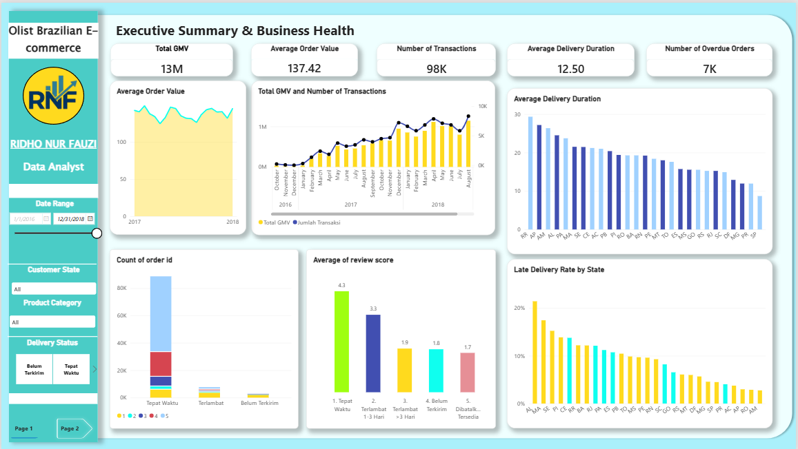
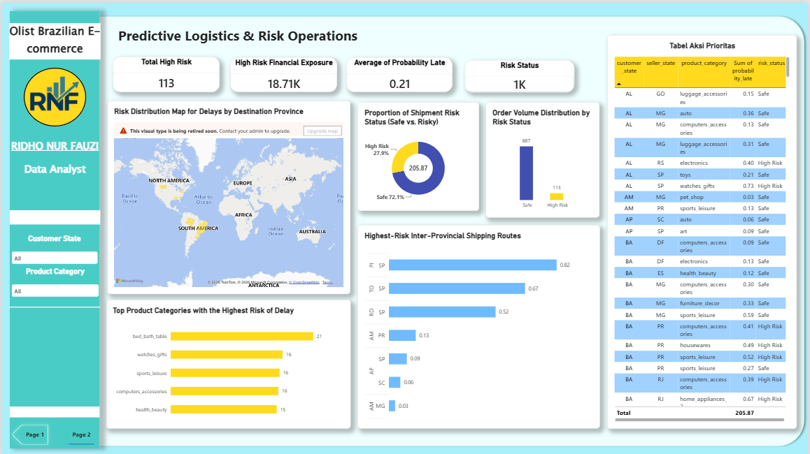

<p align="center">
  
</p>

<h1 align="center">🚚 Predicting Delivery Delay Risks: Olist Brazilian E-Commerce Analytics & Late Delivery Prediction</h1>

<p align="center">
  <a href="https://www.python.org/"></a>
  <a href="https://lightgbm.readthedocs.io/"></a>
  <a href="https://fastapi.tiangolo.com/"></a>
  <a href="https://powerbi.microsoft.com/"></a>
  <a href="https://opensource.org/licenses/MIT"></a>
</p>

<p align="center">
Proyek end-to-end di atas dataset <strong>Olist Brazilian E-Commerce</strong> yang terdiri dari tiga bagian yang saling melengkapi: <strong>(1) Business Analytics</strong> berupa dashboard Power BI untuk memantau kesehatan bisnis dan performa pengiriman, <strong>(2) Data Science</strong> berupa model <strong>LightGBM</strong> yang memprediksi apakah sebuah pesanan berisiko terlambat tiba, dan <strong>(3) Deployment</strong> berupa <strong>REST API (FastAPI)</strong> serta integrasi prediksi massal langsung di Power BI lewat skrip Python.
</p>

**Author:** Ridho Nur Fauzi | Data Analyst & ML/DL Engineer / Data Scientist  
**Tools Used:** Power BI, DAX, Python (pandas, numpy, scikit-learn, LightGBM, joblib), FastAPI  
**Dataset:** Olist Brazilian E-Commerce Public Dataset (Customers, Orders, Order Items, Sellers, Products, Geolocation, Reviews, Payments)


---

## 📑 Daftar Isi

- [Akses & Download](#-akses--download)
- [Project Overview](#-project-overview)
- [Ringkasan Eksekutif](#-ringkasan-eksekutif)
- [Key Performance Indicators (KPIs)](#-key-performance-indicators-kpis)
- [Problem Definition & Karakteristik Dataset](#-problem-definition--karakteristik-dataset)
- [Data Cleaning & Preprocessing](#-data-cleaning--preprocessing)
- [Bagian 1: Analisis Dashboard Power BI](#-bagian-1-analisis-dashboard-power-bi)
- [Bagian 2: Pemodelan Prediksi Keterlambatan](#-bagian-2-pemodelan-prediksi-keterlambatan)
- [Evaluasi Model](#-evaluasi-model)
- [Bagian 3: Deployment (API & Integrasi Power BI)](#-bagian-3-deployment-api--integrasi-power-bi)
- [Tech Stack & Alat](#️-tech-stack--alat)
- [Struktur Proyek](#-struktur-proyek)
- [Cara Menjalankan Proyek](#-cara-menjalankan-proyek)
- [Keterbatasan & Pengembangan Selanjutnya](#️-keterbatasan--pengembangan-selanjutnya)
- [Kontak](#-kontak)

---

## 🚀 Akses & Download

- 📥 **Download Project File:** File Power BI (`.pbix`) tersedia di folder `model/` pada repositori ini untuk mempelajari struktur data, DAX, dan skrip Python yang tertanam.
- 📓 **Notebook Python:** Seluruh proses merge data, cleaning, feature engineering, pemodelan, dan ekspor model ada di `Olist_Brazillian_E-Commerce.ipynb`.
- ⚡ **REST API:** Layanan prediksi real-time ada di `main.py` (FastAPI). Lihat [Cara Menjalankan Proyek](#-cara-menjalankan-proyek).

---

## 📌 Project Overview

Proyek ini mengupas dataset Olist dari tiga sudut pandang. Dari sisi **analitik**, dibangun dashboard dua halaman di Power BI: halaman pertama memantau kesehatan bisnis (GMV, nilai order, durasi dan keterlambatan pengiriman per negara bagian, serta dampaknya ke skor review), sedangkan halaman kedua menampilkan **Predictive Logistics & Risk Operations** yang memetakan pesanan berisiko terlambat. Dari sisi ***data science***, dibangun model klasifikasi LightGBM yang memprediksi probabilitas sebuah pesanan terlambat dari fitur yang sudah diketahui **sebelum barang dikirim** (rute, bobot, volume, jarak, estimasi pengiriman, waktu pembelian). Dari sisi ***deployment***, model dibungkus menjadi REST API dan dipanggil massal di dalam Power BI sehingga hasil prediksi langsung menjadi tabel aksi prioritas bagi tim operasional.

Proyek ini mencakup proses ***End-to-End Data Science***: penggabungan 6 tabel relasional, pembersihan data, rekayasa fitur (termasuk jarak Haversine dan *target encoding* bebas kebocoran), pemodelan dengan *group-aware split*, penentuan *threshold* optimal, hingga integrasi ke dashboard dan API.

---

## 📊 Ringkasan Eksekutif

| Parameter | Detail |
|---|---|
| **Dataset & Ukuran** | Olist Brazilian E-Commerce, ±99 ribu pesanan, 112.650 item, 3.095 seller |
| **Target Prediksi** | `is_late`: tanggal diterima pelanggan melewati tanggal estimasi (hanya pesanan berstatus *delivered*) |
| **Data Uji** | 19.288 baris (1.558 terlambat, ±8,1%) |
| **Model** | LightGBM Classifier + early stopping + *scale_pos_weight* |
| **Penanganan Kebocoran** | `GroupShuffleSplit` per `order_id`, *out-of-fold target encoding* dengan `GroupKFold` |
| **Penentuan Threshold** | Memaksimalkan F1 pada kurva Precision-Recall (validation set) |
| **ROC-AUC** | 0,738 |
| **PR-AUC** | 0,225 |
| **Deployment** | FastAPI (`/predict`) dan skrip Python di Power BI (prediksi massal) |

---

## 📊 Key Performance Indicators (KPIs)

Berdasarkan dashboard halaman *Executive Summary & Business Health*:

- **Total GMV:** 13 juta.
- **Average Order Value:** 137,42.
- **Jumlah Transaksi:** ±98 ribu.
- **Rata-Rata Durasi Pengiriman:** 12,50 hari.
- **Pesanan Terlambat (Overdue):** ±7 ribu pesanan.

---

## 📑 Problem Definition & Karakteristik Dataset

### 1. Masalah & Tujuan

**Analitik (Power BI):**
- Memantau kesehatan bisnis e-commerce dan mengidentifikasi wilayah dengan performa pengiriman terburuk.
- Mengukur dampak keterlambatan terhadap kepuasan pelanggan (skor review).

**Data Science (Python):**
- **Memprediksi probabilitas keterlambatan** sebuah pesanan sebelum dikirim.
- **Menandai pesanan High Risk** agar tim logistik bisa memprioritaskan tindakan (mis. ganti kurir, hubungi seller, atau beri tahu pelanggan lebih awal).

### 2. Tantangan Spesifik Dataset

- **Class imbalance**: hanya ±8% pesanan yang terlambat, sehingga akurasi saja menyesatkan dan metrik PR-AUC serta F1 kelas positif lebih relevan.
- **Banyak tabel relasional**: data tersebar di customers, orders, order_items, sellers, products, dan geolocation yang harus digabung tanpa menduplikasi pesanan.
- **Satu order, banyak item**: item per order diagregasi agar satu baris mewakili satu order, dan split dilakukan per `order_id` untuk mencegah kebocoran.
- **Fitur kategorikal kardinalitas tinggi**: rute (pasangan negara bagian customer-seller) dan kategori produk ditangani dengan *smoothed target encoding*.
- **Nilai kosong**: tanggal pengiriman kosong (1.783 baris kurir, 2.965 baris pelanggan) dan atribut produk kosong (610 baris kategori, 2 baris dimensi/berat).

### 3. Struktur Data

- **Orders**: status dan seluruh timestamp pesanan (pembelian, persetujuan, kurir, pelanggan, estimasi).
- **Order Items**: harga, ongkir, seller, produk, batas waktu pengiriman seller.
- **Customers & Sellers**: negara bagian dan kode pos.
- **Products**: kategori, bobot, dimensi.
- **Geolocation**: koordinat per prefix kode pos (1.000.163 baris).

---

## 🧹 Data Cleaning & Preprocessing

| Isu yang Ditemukan | Tindakan |
|---|---|
| Satu order bisa memiliki banyak item | Diagregasi per `order_id` (ongkir dan harga dijumlahkan, seller/produk diambil yang pertama) |
| Kolom ganda hasil merge | Dihapus dengan `~columns.duplicated()` |
| Pesanan belum selesai (canceled, shipped, dll.) | Difilter, hanya `order_status == 'delivered'` yang dipakai |
| Kolom tanggal bertipe teks | Dikonversi ke `datetime` (`errors='coerce'`) |
| Tanggal approval/kurir/pelanggan/batas kirim kosong, serta bobot dan volume produk kosong | Baris dibuang (`dropna`) |
| Kategori produk kosong | Diisi `unknown` |
| Baris duplikat | Dihapus dengan `drop_duplicates` |
| Rute dan kategori berkardinalitas tinggi | *Smoothed target encoding* (smoothing = 20) dengan fallback ke *prior* untuk kategori yang belum pernah terlihat |

### Feature Engineering

| Kelompok | Fitur |
|---|---|
| **Durasi** | `estimated_delivery_days`, `allowed_processing_days`, `estimated_courier_days` |
| **Waktu** | `is_weekend_purchase`, `is_night_purchase` (22:00–05:59) |
| **Fisik & Harga** | `freight_ratio`, `product_density`, `product_volume_cm3`, `product_weight_g` |
| **Spasial** | `distance_km` (Haversine dari rata-rata koordinat prefix kode pos), `is_same_state` |
| **Risiko Historis** | `historical_route_risk`, `historical_category_risk` |
| **Interaksi** | `route_volume_risk`, `route_weight_risk` (risiko rute × volume/berat) |

---

## 💡 Bagian 1: Analisis Dashboard Power BI

### Halaman 1: Executive Summary & Business Health



### 1. Pertumbuhan Bisnis yang Konsisten

Grafik **Total GMV and Number of Transactions** menunjukkan GMV dan jumlah transaksi tumbuh stabil sepanjang 2017 dan mencapai puncak di akhir 2017 hingga pertengahan 2018, sementara **Average Order Value** relatif datar di kisaran 130–150. Artinya pertumbuhan berasal dari bertambahnya volume transaksi, bukan dari kenaikan nilai per order.

### 2. Ketimpangan Durasi Pengiriman Antar Wilayah

Pada **Average Delivery Duration**, wilayah terpencil seperti **RR, AP, dan AM** memiliki durasi rata-rata mendekati 25–30 hari, sedangkan **SP** (basis mayoritas seller) tercepat dengan sekitar 9 hari. Jarak dan jangkauan logistik jelas berpengaruh pada waktu tempuh.

### 3. Tingkat Keterlambatan Tertinggi di Wilayah Timur Laut

**Late Delivery Rate by State** menempatkan **AL** (±21%) di posisi teratas, diikuti **MA, SE, PI, dan CE**. Wilayah ini menjadi target prioritas perbaikan layanan logistik.

### 4. Keterlambatan Langsung Menekan Kepuasan Pelanggan

Pada **Average of Review Score**, pesanan yang tiba tepat waktu mendapat skor **4,3**, turun menjadi **3,3** jika terlambat 1–3 hari, dan anjlok ke **1,9** jika terlambat lebih dari 3 hari. Keterlambatan panjang hampir setara dengan pesanan yang belum dikirim atau tidak tersedia (1,7–1,8), sehingga mencegah keterlambatan berdampak langsung ke reputasi platform.

### Halaman 2: Predictive Logistics & Risk Operations



Halaman ini memakai **1.000 sampel data uji** yang sudah diprediksi oleh model.

### 5. Sebaran Risiko pada Sampel Prediksi

Dari 1.000 pesanan sampel, **113 pesanan (±11%) diklasifikasikan High Risk** dengan eksposur finansial sekitar **18,71 ribu**, dan rata-rata probabilitas terlambat **0,21**.

### 6. Rute dan Kategori Paling Berisiko

- Pada **Highest-Risk Inter-Provincial Shipping Routes**, rute dengan skor tertinggi adalah pengiriman ke **PI (0,82)**, **TO (0,67)**, dan **RO (0,52)** dari seller di **SP**. Pola ini konsisten dengan tingginya tingkat keterlambatan di wilayah timur laut dan utara pada halaman 1.
- Pada **Top Product Categories with the Highest Risk of Delay**, kategori **bed_bath_table (21)** memimpin, disusul **watches_gifts, sports_leisure, computers_accessories (masing-masing 16)**, dan **health_beauty (15)**.

### 7. Tabel Aksi Prioritas

**Tabel Aksi Prioritas** menampilkan kombinasi negara bagian customer, seller, kategori produk, probabilitas terlambat, dan status risiko sehingga tim operasional bisa langsung memilah pesanan mana yang perlu ditindak lebih dulu.

---

## 🧠 Bagian 2: Pemodelan Prediksi Keterlambatan

### 1. Strategi Split & Pencegahan Data Leakage

- **`GroupShuffleSplit`** (80/20) berdasarkan `order_id` agar item dari order yang sama tidak terbelah ke train dan test.
- **Out-of-fold target encoding** (`GroupKFold`, 5 fold, smoothing 20): nilai encoding untuk data training dihitung dari fold lain, sedangkan data uji memakai kamus dari seluruh data training, sehingga label tidak bocor ke fitur.
- Validation set (20% dari train, *group split* terpisah) dipakai untuk early stopping dan penentuan threshold, sehingga test set tidak pernah dipakai untuk tuning.

### 2. Model LightGBM

| Hyperparameter | Nilai |
|---|---|
| `n_estimators` | 3000 (dengan *early stopping* 100 putaran) |
| `learning_rate` | 0,03 |
| `num_leaves` | 15 |
| `min_child_samples` | 100 |
| `reg_lambda` | 5 |
| `scale_pos_weight` | √(jumlah kelas 0 / jumlah kelas 1) |
| `metric` | `average_precision` |

Model dibuat sengaja sederhana dan teregularisasi (daun sedikit, `min_child_samples` besar) karena sinyal pada data cukup lemah dan rawan *overfit*.

### 3. Threshold Tuning

Karena kelas positif langka, threshold default 0,5 tidak cocok. Threshold dipilih dari titik yang memaksimalkan **F1-score** pada kurva Precision-Recall di validation set (parameter `beta` dapat diubah untuk memberi bobot lebih besar pada *recall*). Model dan threshold disimpan bersama dalam satu file `late_delivery_model.pkl`.

---

## 📈 Evaluasi Model

| Metrik | Skor |
|---|---|
| ROC-AUC | 0,738 |
| PR-AUC | 0,225 |
| Accuracy | 0,861 |

| Kelas | Precision | Recall | F1-score | Support |
|---|---|---|---|---|
| Tepat Waktu (False) | 0,940 | 0,906 | 0,923 | 17.730 |
| Terlambat (True) | 0,244 | 0,343 | 0,285 | 1.558 |

- **PR-AUC 0,225** dibandingkan *baseline* acak sekitar 0,081 (proporsi kelas positif) berarti model sekitar **2,8× lebih baik dari tebakan acak** dalam mengurutkan pesanan berisiko.
- Model menangkap sekitar **34% pesanan yang benar-benar terlambat**, dengan **24% dari peringatan High Risk** yang benar. Hasil ini cocok sebagai alat **prioritisasi** (pesanan mana yang dipantau lebih dulu), bukan sebagai penentu mutlak.
- Akurasi 86% tidak boleh dibaca sendirian: model yang selalu menebak "tepat waktu" saja sudah mencapai sekitar 92%. Karena itu F1 dan PR-AUC kelas terlambat dijadikan acuan utama.

---

## ⚡ Bagian 3: Deployment (API & Integrasi Power BI)

### 1. REST API (FastAPI)

Endpoint `POST /predict` menerima data satu pesanan, menghitung seluruh fitur turunan dan *encoding* secara otomatis, lalu mengembalikan probabilitas dan status risiko.

**Contoh request:**

```json
{
  "freight_value": 25.5,
  "price": 120.0,
  "product_weight_g": 1500,
  "product_volume_cm3": 8000,
  "estimated_delivery_days": 22,
  "allowed_processing_days": 3,
  "distance_km": 1800,
  "customer_state": "PI",
  "seller_state": "SP",
  "product_category": "bed_bath_table",
  "purchase_dayofweek": 5,
  "purchase_hour": 23
}
```

**Contoh response:**

```json
{
  "probability_late": 0.6123,
  "is_late_prediction": 1,
  "status": "High Risk",
  "route_analyzed": "PI_SP"
}
```

> Angka pada contoh di atas hanya ilustrasi format; hasil sebenarnya bergantung pada model yang dimuat.

Dokumentasi interaktif (Swagger UI) tersedia otomatis di `http://127.0.0.1:8000/docs`.

### 2. Prediksi Massal di Power BI

Halaman 2 dashboard memakai **skrip Python di Power Query / visual Python**: file `data_siap_prediksi.csv` (1.000 sampel data uji) dimuat, fitur risiko rute dan kategori dihitung ulang memakai `encoding_maps.pkl`, lalu `late_delivery_model.pkl` menghasilkan kolom `probability_late` dan `risk_status` (High Risk jika probabilitas ≥ threshold). Dengan cara ini hasil model langsung menjadi KPI, grafik, dan tabel aksi prioritas tanpa perlu menjalankan server.

---

## 🛠️ Tech Stack & Alat

* **Dashboard & Analitik**: Power BI, DAX
* **Bahasa**: Python 3.10
* **Manipulasi & Analisis Data**: `pandas`, `numpy`
* **Pemodelan**: `lightgbm`, `scikit-learn` (`GroupShuffleSplit`, `GroupKFold`, `precision_recall_curve`)
* **Serialisasi Model**: `joblib`
* **API**: `fastapi`, `pydantic`, `uvicorn`

---

## 📁 Struktur Proyek

```text
.
├── Dataset/
│   ├── olist_*.csv                   # Dataset mentah Olist
│   └── data_siap_prediksi.csv        # 1.000 sampel data uji untuk Power BI
├── Model/
│   ├── late_delivery_model.pkl       # Model LightGBM + threshold
│   └── encoding_maps.pkl             # Kamus target encoding (rute, kategori, prior)
├── Notebook/
│   └── Olist_Brazillian_E-Commerce.ipynb
├── model/                            # File Power BI (.pbix)
├── images/                           # Preview dashboard
│   ├── Olist.jpg
│   ├── Halaman_1.png
│   └── Halaman_2.png
├── main.py                           # REST API (FastAPI)
└── README.md
```

> Sesuaikan struktur di atas dengan susunan folder repositori Anda yang sebenarnya.

---

## 🚀 Cara Menjalankan Proyek

### Dashboard Power BI

Buka file `.pbix` di folder `model/` menggunakan Power BI Desktop. Pada halaman 2, pastikan Python sudah terpasang dan ubah path file (`data_siap_prediksi.csv`, `late_delivery_model.pkl`, `encoding_maps.pkl`) pada skrip Python sesuai lokasi di komputer Anda.

### Notebook & API

1. **Clone repository ini**
   ```bash
   git clone https://github.com/RidhoNurFauzi/Predicting-Delivery-Delay-Risks-for-Olist-Brazilian-E-Commerce.git
   cd Predicting-Delivery-Delay-Risks-for-Olist-Brazilian-E-Commerce
   ```

2. **Buat virtual environment (opsional tapi disarankan)**
   ```bash
   python -m venv venv
   source venv/bin/activate      # Linux/Mac
   venv\Scripts\activate         # Windows
   ```

3. **Install dependensi**
   ```bash
   pip install -r requirements.txt
   ```

4. **Latih ulang model (opsional)**
   Jalankan `Olist_Brazillian_E-Commerce.ipynb` secara berurutan (`Kernel → Restart & Run All`). Notebook akan mengekspor `late_delivery_model.pkl`, `encoding_maps.pkl`, dan `data_siap_prediksi.csv`.

5. **Jalankan API**
   ```bash
   uvicorn main:app --reload
   ```
   Lalu buka `http://127.0.0.1:8000/docs` untuk mencoba endpoint `/predict`.

**Sumber Dataset:** [Brazilian E-Commerce Public Dataset by Olist (Kaggle)](https://www.kaggle.com/datasets/olistbr/brazilian-ecommerce)

---

## ⚠️ Keterbatasan & Pengembangan Selanjutnya

1. Daya prediksi masih moderat (PR-AUC 0,225, recall kelas terlambat 34%); fitur yang tersedia sebelum pengiriman terbatas. Menambah data seperti kinerja historis per seller, beban kurir, cuaca, libur nasional, dan kepadatan rute berpotensi meningkatkan performa.
2. Probabilitas keluaran model belum dikalibrasi karena memakai `scale_pos_weight`, sehingga nilainya (mis. rata-rata 0,21) lebih tepat dibaca sebagai **skor peringkat risiko** daripada peluang sebenarnya; kalibrasi (isotonic atau Platt) menjadi langkah lanjutan.
3. Threshold dioptimalkan untuk F1; pada praktiknya threshold sebaiknya disesuaikan dengan biaya bisnis (biaya intervensi vs biaya keterlambatan) atau memakai `beta` > 1 untuk mengutamakan recall.
4. Dashboard halaman 2 hanya memakai 1.000 sampel data uji sebagai demonstrasi; sistem produksi perlu pipeline yang memprediksi pesanan baru secara berkala atau melalui API.
5. Persentase pada donut *Proportion of Shipment Risk Status* dihitung dari jumlah probabilitas, bukan jumlah pesanan, sehingga angkanya (±28%) berbeda dari proporsi jumlah pesanan High Risk (113 dari 1.000).
6. Visual peta bawaan Power BI yang dipakai sudah akan dihentikan Microsoft; perlu dimigrasikan ke Azure Maps atau *Filled Map*.
7. Pembaruan model memerlukan pelatihan ulang manual; versi model dan monitoring *data drift* belum diterapkan.

---

## 📬 Kontak

**Ridho Nur Fauzi**  
Data Analyst & ML/DL Engineer / Data Scientist

* 🌐 Portfolio: [ridhonurfauzi.netlify.app](https://ridhonurfauzi.netlify.app/)
* 💼 Terbuka untuk diskusi kolaborasi proyek data analytics, data science & machine learning

---

<p align="center"><em>Dibuat sebagai bagian dari proyek analitik dan prediksi risiko keterlambatan pengiriman menggunakan dataset Olist Brazilian E-Commerce.</em></p>